# Hanami

[](https://github.com/Khaiyen-Salaria/Hanami/releases)
[](https://flask.palletsprojects.com/)
[](LICENSE)

**A self-hosted client and project management workspace for independent web developers and small studios.** Manage the full website-delivery journey—from a first client inquiry to launch, handover, and ongoing maintenance—in one place.

<p align="center">
  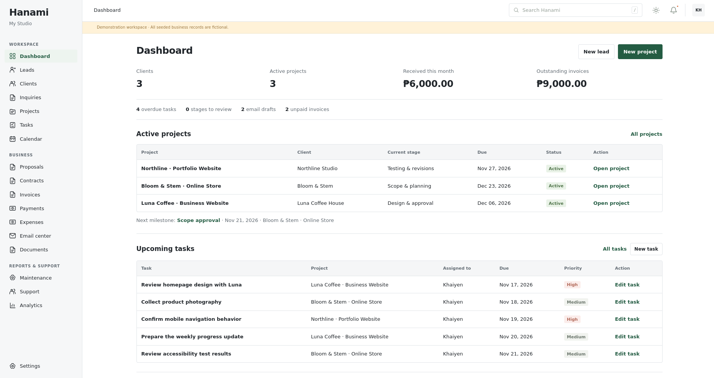
</p>

Hanami brings client records, project delivery, tasks, commercial documents, communication, and support into one Flask application backed by SQLite. It is designed to make project progress visible while keeping important business decisions explicit and reviewable.

## Why Hanami?

Website projects often spread information across spreadsheets, email threads, task boards, and document folders. Hanami connects those pieces around the client and project, so the work and its supporting decisions stay together.

- **One client-to-delivery workflow.** Track leads, inquiries, clients, projects, and the fourteen-stage website lifecycle.
- **Clear project execution.** Organize tasks, dependencies, milestones, calendar events, design revisions, QA cases, launch records, and handover evidence.
- **Commercial records in context.** Prepare proposals, contracts, invoices, payments, and expenses, with PDF and CSV exports where supported.
- **Communication and follow-through.** Draft and review email, manage document templates, and track maintenance and support work.
- **Operational visibility.** Use the dashboard, search, analytics, notifications, and scheduled automation to keep outstanding work visible.

## At a glance

| | |
| --- | --- |
| **Application** | Python 3.12 · Flask · Jinja · vanilla JavaScript |
| **Data layer** | SQLite · SQLAlchemy · Flask-Migrate |
| **Background work** | APScheduler (separate scheduler process) |
| **Documents and email** | ReportLab PDF generation · SMTP email workflow |
| **Interface** | Responsive layout · light/dark themes · calendar · CSV/PDF exports |

## Screenshots

The screenshots below use the fictional demonstration workspace. They are included to show the current interface, not real client or business records.

### Clients and project delivery

| Lead pipeline | Project board |
| --- | --- |
| 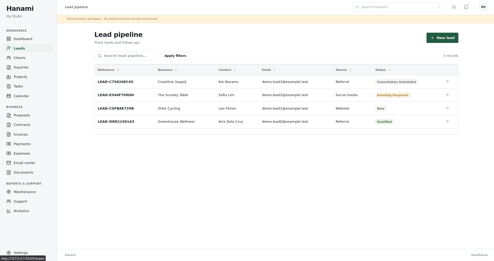 | 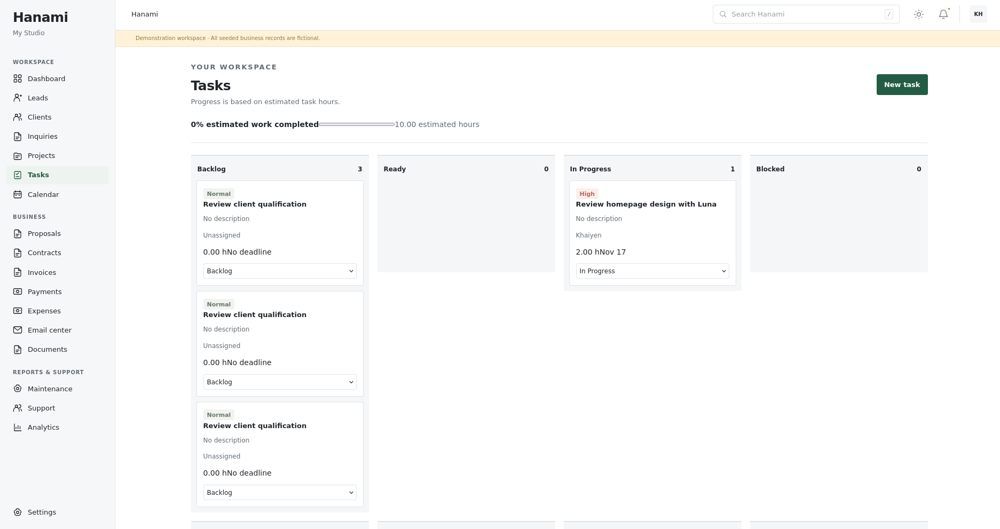 |

| Project overview | Calendar |
| --- | --- |
| 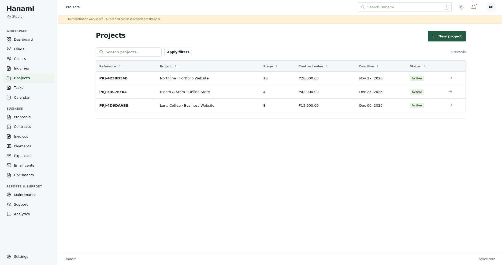 | 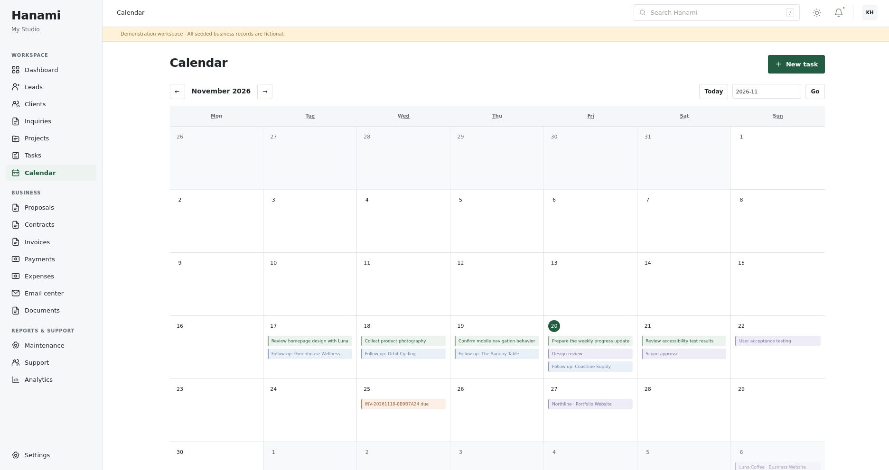 |

### Proposals, finance, and documents

| Proposals | Invoices |
| --- | --- |
| 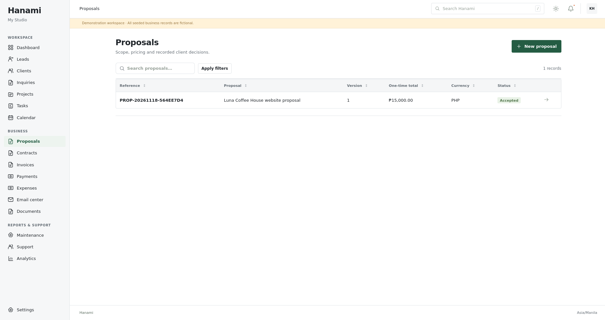 | 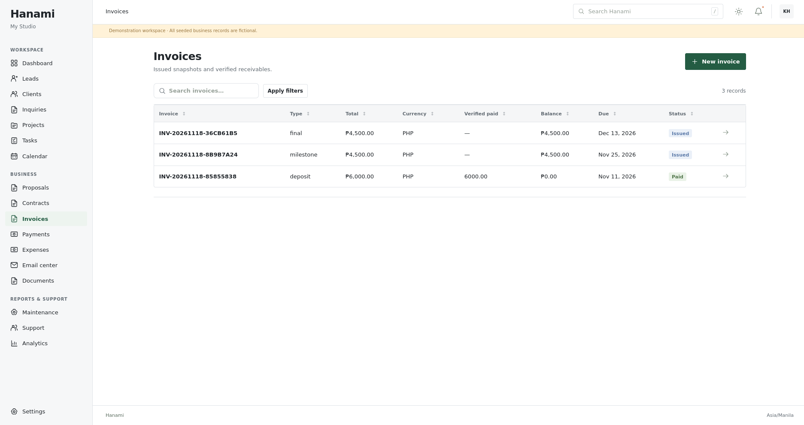 |

| Email center | Document library |
| --- | --- |
| 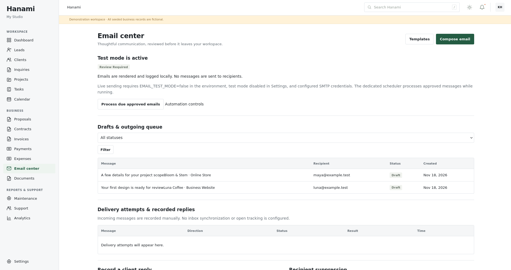 | 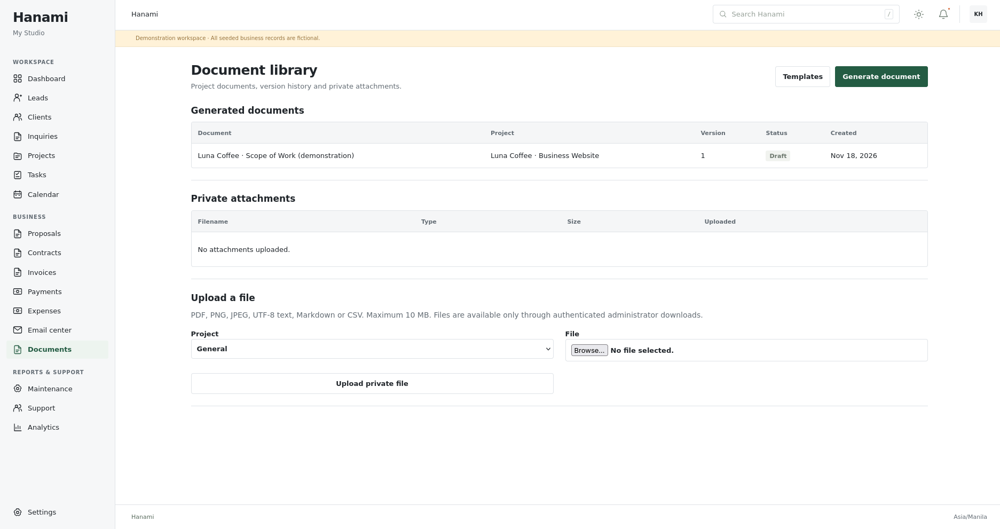 |

### Reporting and operations

| Analytics | Automation controls |
| --- | --- |
| 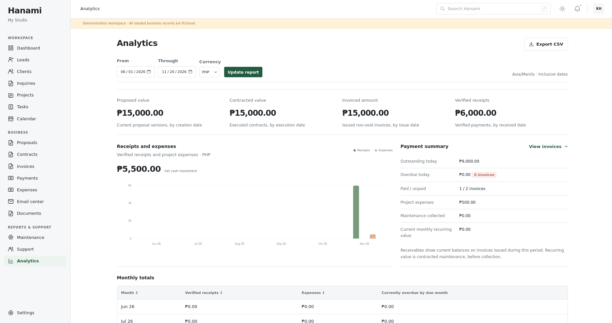 | 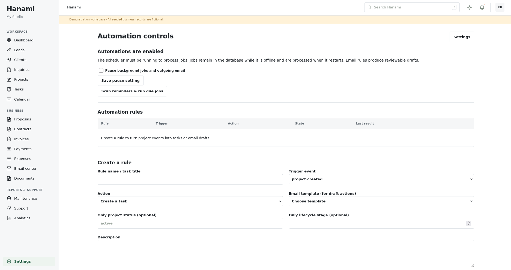 |

<details>
  <summary>View the rest of the interface screenshots</summary>

  **Clients**

  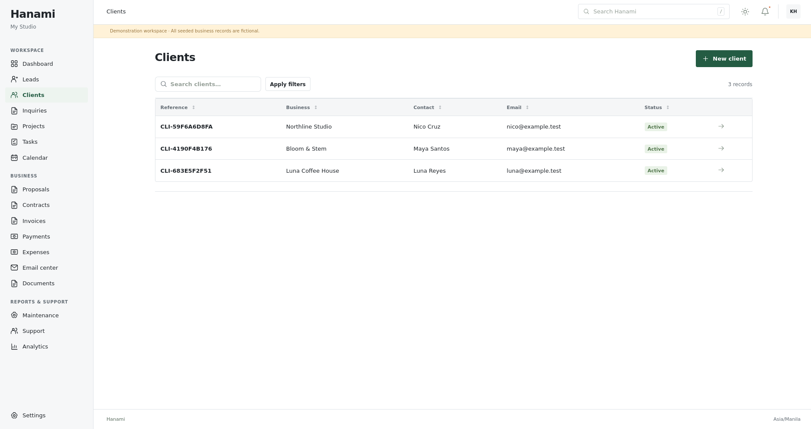

  **Inquiries**

  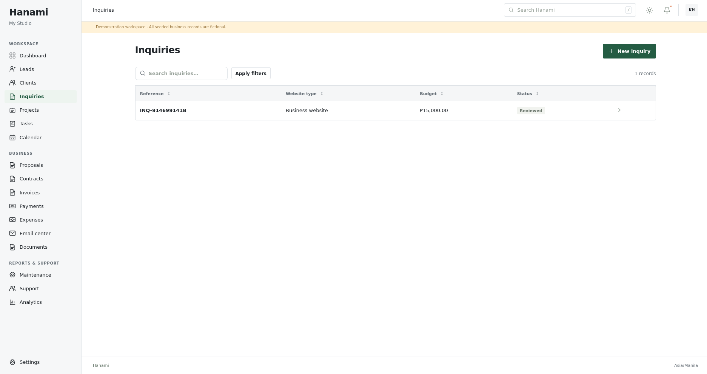

  **Contracts**

  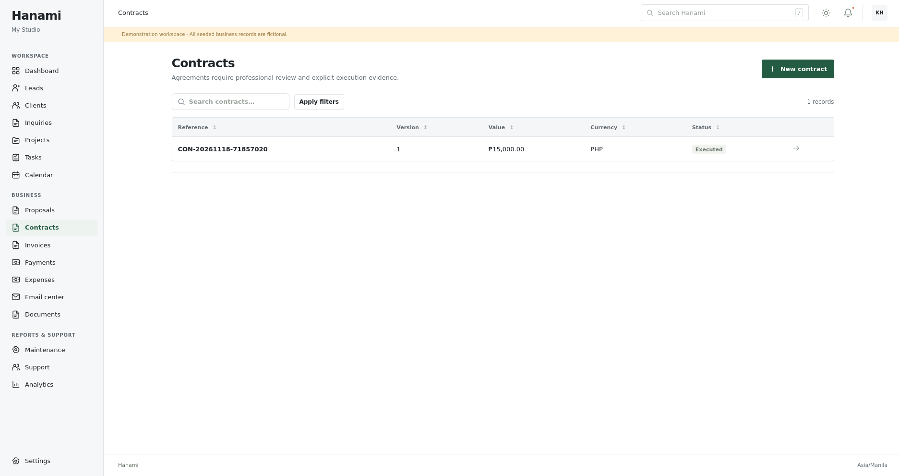

  **Payments**

  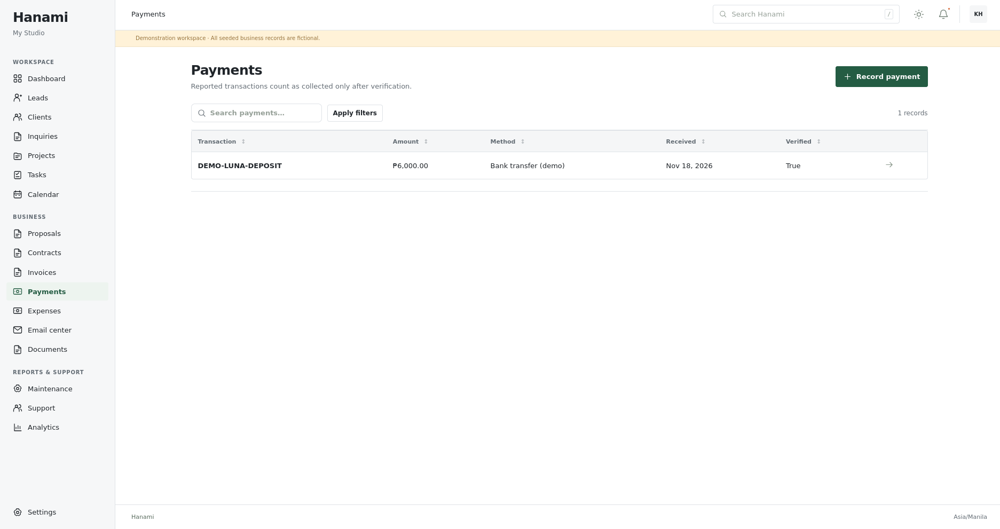

  **Expenses**

  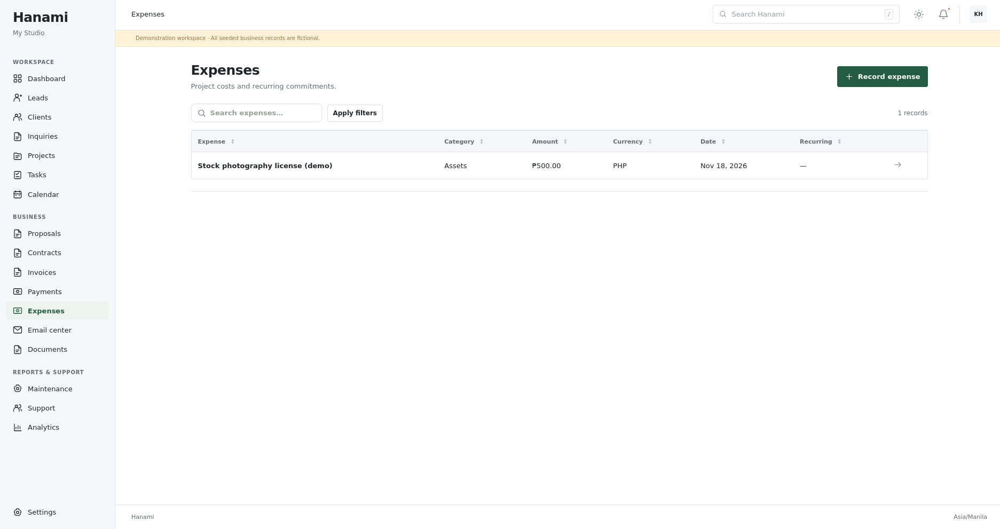

  **Maintenance**

  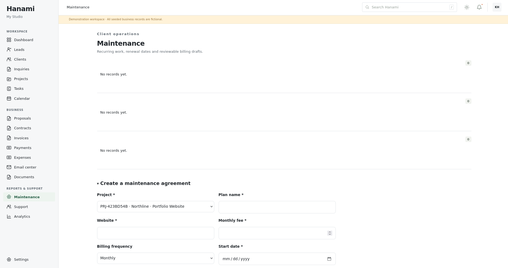

  **Support tickets**

  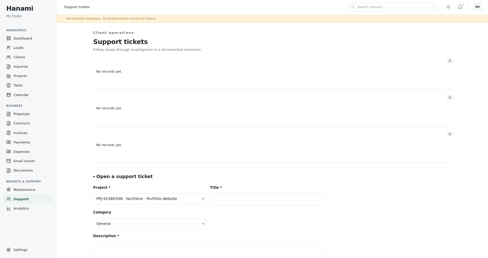

  **Settings**

  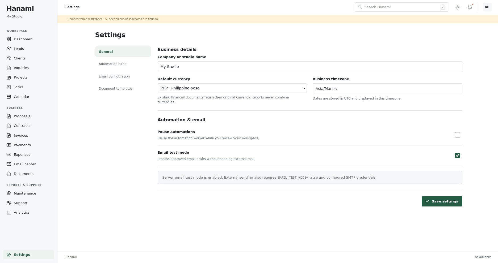

  **Document templates**

  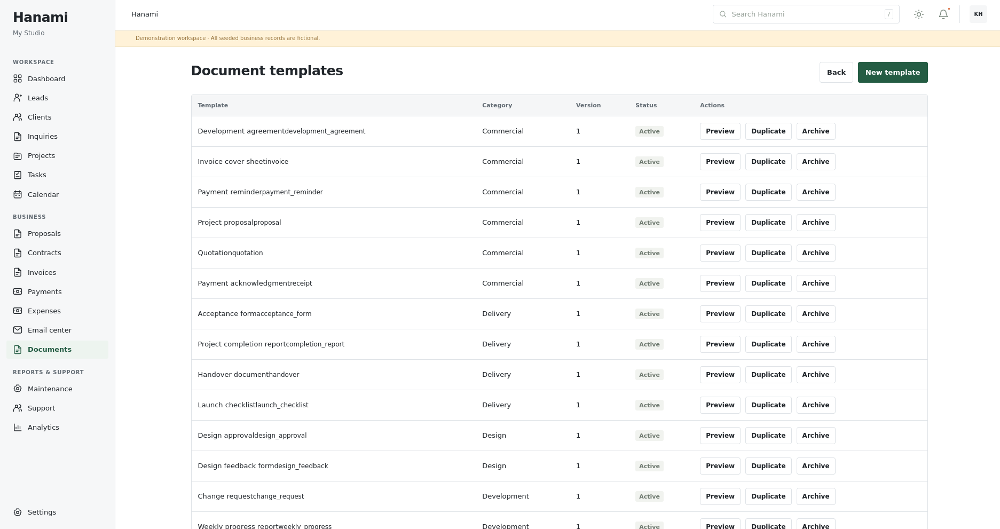
</details>

## The website project lifecycle

Every new project is organized into fourteen stages. Each stage can carry its own records, checklist items, approvals, and completion requirements.

1. Client acquisition
2. Initial inquiry
3. Discovery and consultation
4. Scope and planning
5. Proposal and quotation
6. Contract and deposit
7. Client onboarding
8. Design and approval
9. Website development
10. Testing and revisions
11. Final acceptance and payment
12. Deployment and launch
13. Handover and training
14. Maintenance and support

Hanami keeps key decisions separate: sending an email does not accept a proposal, recording a payment does not verify it, and completing a checklist does not authorize a launch. The application stores the supporting evidence; people remain responsible for those decisions.

## Getting started

### Requirements

- Python **3.12**
- Git
- Linux or macOS for the full web-and-scheduler workflow; Windows users should use **WSL** for the scheduler, which relies on a POSIX process lock

### 1. Clone the repository

```bash
git clone https://github.com/Khaiyen-Salaria/Hanami.git
cd Hanami
```

### 2. Create a virtual environment and install dependencies

```bash
python3.12 -m venv .venv
source .venv/bin/activate
python -m pip install --upgrade pip
python -m pip install -r requirements-dev.txt
```

For a runtime-only install without test and lint tools, use `requirements.txt` instead of `requirements-dev.txt`.

On Windows PowerShell, create and activate the web application's environment with:

```powershell
py -3.12 -m venv .venv
.venv\Scripts\Activate.ps1
python -m pip install -r requirements-dev.txt
```

Use WSL for the complete workflow, including the scheduler.

### 3. Configure the environment

Create your local environment file:

```bash
cp .env.example .env
```

Generate a secret key:

```bash
python -c "import secrets; print(secrets.token_hex(32))"
```

Put the generated value in `SECRET_KEY` in `.env`. The example file already provides development defaults for the SQLite database, `Asia/Manila` timezone, `PHP` currency, secure-cookie setting for local HTTP, email test mode, and automation controls. Review these values before running the application.

**Keep `.env`, database files, uploads, exports, and backups out of version control.** Production requires an explicit, stable `SECRET_KEY` of at least 32 characters and HTTPS-secure cookies.

### 4. Create the database and default templates

```bash
flask --app run:create_app db upgrade
flask --app run:create_app seed-templates
```

### 5. Create your administrator account

```bash
flask --app run:create_app create-admin --email you@example.com --name "Your Name"
```

Replace the sample email and name. The command securely prompts for a password of at least twelve characters. Hanami does not create a default account or shared password.

### 6. Start the web application

```bash
flask --app run:create_app run --host 127.0.0.1 --port 5000
```

Open [http://127.0.0.1:5000](http://127.0.0.1:5000) and sign in with the administrator account you created.

### 7. Start the scheduler

In a **second terminal**, from the repository root, activate the same virtual environment and run:

```bash
python -m scheduler
```

Run exactly one scheduler for each application instance. It processes scheduled jobs and approved email queues separately from the web server. Scheduled work does not execute while the scheduler process or its host is stopped.

## Try the demo workspace

Hanami includes fictional seed data for exploring the application. Only run this against a fresh development database, after creating an administrator:

```bash
flask --app run:create_app seed-demo
```

The demo includes sample businesses, projects, tasks, proposals, invoices, payment examples, documents, drafts, and maintenance records. The workspace is labeled as a demonstration and keeps email in test mode.

**Do not seed a database that contains real business data.** For evaluation, use a separate database and follow the setup steps for that database before seeding it.

## Development checks

Run the test suite and lint checks from the repository root:

```bash
pytest -q
ruff check app tests scheduler run.py
ruff format --check app tests scheduler migrations
```

Tests use isolated databases and simulated or mocked SMTP; they are not intended to run against a production database.

## Configuration

Hanami reads environment variables from `.env` during local development. The main settings are:

| Variable | Purpose |
| --- | --- |
| `APP_ENV` | `development` or `production` |
| `SECRET_KEY` | Session and CSRF signing secret; required explicitly in production |
| `DATABASE_URL` | SQLAlchemy database URL; defaults to a local SQLite database |
| `BUSINESS_TIMEZONE` | Timezone used to display business dates; defaults to `Asia/Manila` |
| `DEFAULT_CURRENCY` | Default currency for business records; defaults to `PHP` |
| `SESSION_COOKIE_SECURE` | Set to `true` when served over HTTPS |
| `EMAIL_TEST_MODE` | Keeps outgoing email simulated when `true` |
| `SMTP_HOST`, `SMTP_PORT` | SMTP server settings for live email |
| `SMTP_USER`, `SMTP_PASSWORD` | SMTP account credentials; keep them private |
| `AUTOMATIONS_PAUSED` | Pauses scheduled automation without deleting its records |
| `RATELIMIT_STORAGE_URI` | Rate-limit storage backend; defaults to per-process memory |

Live email requires private SMTP credentials **and** test mode to be disabled both in the environment and in the application's Email Center settings. Test sending to your own address before using live email with clients. Never commit credentials or put passwords in CRM notes.

## Project structure

```text
Hanami/
├── app/                 # Flask application, blueprints, models, services, templates, and static files
├── docs/                # User, deployment, validation, requirements, and architecture guides
├── migrations/          # Database schema migrations
├── scheduler/           # Dedicated background scheduler
├── scripts/             # Setup and maintenance scripts
├── tests/               # Automated tests
├── .env.example         # Environment variable template
├── requirements.txt     # Runtime dependencies
├── requirements-dev.txt # Runtime + development dependencies
├── run.py               # Application entry point and CLI registration
└── pytest.ini           # Pytest configuration
```

## Documentation

- [User guide](docs/user-guide.md) — workflows from lead qualification through maintenance and support.
- [Deployment and operations](docs/deployment.md) — production setup, environment configuration, scheduler operation, backups, and recovery.
- [Validation record](docs/validation.md) — recorded test, lint, and interface checks, including known integration limits.
- [Requirements](docs/requirements.md) — product requirements and acceptance criteria.
- [Architecture](docs/architecture.md) — application structure, models, services, and internal design contracts.

## Important scope and limitations

Hanami is an operational CRM and project-tracking application. In its current release:

- Access is administrator-only; granular team permissions and a client portal are not included.
- SQLite is intended for a single application instance with modest write concurrency, not multiple independent hosts sharing one database file.
- Hanami records payment reports and verification evidence; it does **not** process bank or card payments.
- It records launch plans and deployment evidence; it does **not** deploy client websites.
- It records contract execution; it does **not** provide an electronic-signature service.
- Financial summaries support project operations but do not replace a full accounting or tax system.
- Generated legal documents require appropriate professional review.

For persistent hosting, use a production WSGI server such as Waitress behind an HTTPS reverse proxy, and run the scheduler as a separately supervised service. See the [deployment guide](docs/deployment.md) before exposing an instance beyond localhost.

## Contributing

Bug reports, thoughtful suggestions, and pull requests are welcome. For code changes, include or update tests where appropriate and run the development checks above before opening a pull request. Please avoid including real client data, secrets, or production database files in issues and commits.

## License

Hanami is licensed under the **MIT License**. Copyright (c) 2026 Khaiyen Salaria.

The MIT License permits use, copying, modification, distribution, sublicensing, and sale of copies, provided the copyright and permission notice are included with copies or substantial portions of the software. See the [`LICENSE`](LICENSE) file for the full license terms.

Third-party packages and assets may be subject to their own licenses; refer to their respective license and attribution notices.
